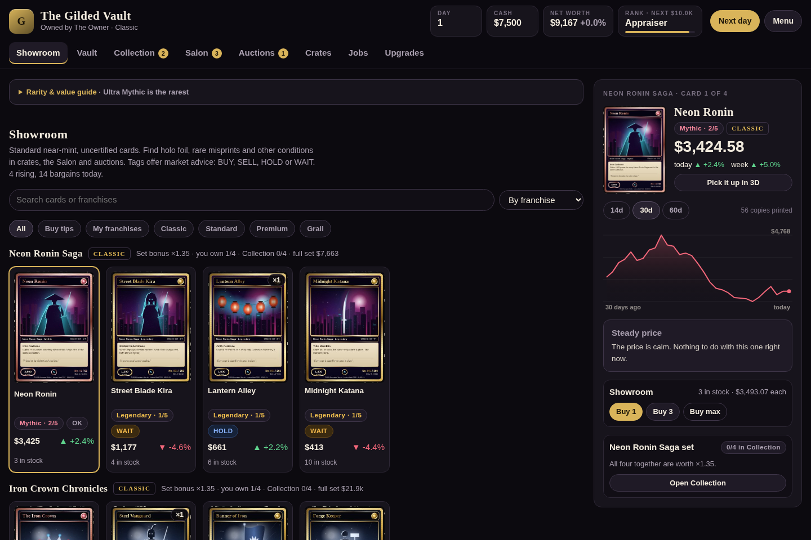

# Luxury Card Tycoon

**Build a card shop. Hunt rare treasures. Become the Vault Tycoon.**

Buy low, inspect suspicious deals, collect holographic misprints, and turn a small shop into a collection worth **$2.5 million** before three rival shops get there first.

**88 card designs · 22 collections · 5 rarity tiers · 3 panorama sets**

[**Download the game**](https://github.com/a2soriano/luxury_card_tycoon/raw/refs/heads/main/luxury-card-tycoon.html) · [How to play](#how-to-play) · [Card values](#what-makes-a-card-valuable) · [Development](#development)



## Play now

1. [Download **luxury-card-tycoon.html**](https://github.com/a2soriano/luxury_card_tycoon/raw/refs/heads/main/luxury-card-tycoon.html).
2. Open the downloaded file in a modern browser.
3. Name your shop, choose a difficulty, and open the doors.

**No installation, account, or API key is needed to play.** The HTML includes the game's code, styles, and generated card artwork. Optional Google Fonts fall back to system fonts when unavailable.

If you open the [file on GitHub](luxury-card-tycoon.html), use **Download raw file**. GitHub's code view displays the source; it does not run the game.

### Run a local server instead

With Python 3 installed, run this from the repository directory:

```sh
python3 -m http.server 8000 --bind 127.0.0.1
```

Open `http://localhost:8000` in your browser. If Node.js is also installed, `npm start` runs the server on port 8000, bound to all network interfaces for cloud development.

## How to play

Start with two Legendary cards and a cash balance determined by your difficulty. Your goal is **$2.5 million in net worth**, including your cash, trading cards, protected cards, and personal collection.

| Area | What you can do |
| --- | --- |
| **Showroom** | Browse standard near-mint cards, follow BUY / SELL / HOLD / WAIT tips, and study price histories. |
| **Vault** | Manage trading stock, submit cards for grading, and lock favorites in the safe box. |
| **Collection** | Assemble four-card sets, earn completion bonuses, and generate gallery income. |
| **Salon** | Negotiate with collectors, inspect sellers' cards, and expose counterfeits. |
| **Auctions** | Bid against other collectors or consign your cards and complete sets. |
| **Crates** | Open crates and franchise boosters for new cards and special variants. |
| **Jobs** | Complete commissions, track trophies, and watch your rivals. |
| **Upgrades** | Improve grading capacity, protect loans, and expand your shop's capabilities. |

Use **Next day** to advance the simulation. Prices change, stock refreshes, new customers arrive, and grading results return. New collections premiere as the days pass; every seventh day is a Convention Day.

## What makes a card valuable?

Each copy has its own finish, condition, certification, serial number, and possible printing error. Two copies of the same card can have very different values.

### Rarity: Legendary → Ultra Mythic

| Rank | Rarity | Typical print run per design |
| --- | --- | ---: |
| 1 / 5 | Legendary | 300 |
| 2 / 5 | Mythic | 80 |
| 3 / 5 | Royal Mythic | 20 |
| 4 / 5 | Cosmic Mythic | 6 |
| 5 / 5 | **Ultra Mythic** | **2** |

**Ultra Mythic is the rarest tier.** Cosmic is rarer than Royal and less rare than Ultra. Print runs vary by card; crate-specific pull odds appear in the Crates tab. Every rarity tag shows its rank, and the expandable **Rarity & value guide** explains the scale in-game.

Ultra Mythics also have a distinctive full-art layout, diamond-engraved frame, and sovereign crest.

### Holographic foil and misprints

- **Holo — 2.5×:** visible iridescent foil and sparkles, with light-reactive materials in the 3D inspector.
- **Double strike — 4×:** a legitimate printing error with visibly doubled details.
- **Offset foil — 3×:** a legitimate printing error with misaligned foil details.

Finish and misprint premiums multiply together with the copy's condition or certified-grade multiplier. For example, a holo Double strike copy has **10×** the value of an otherwise equivalent regular copy.

Find special variants in crates, boosters, seller offers, and auction lots. Legitimate misprints are separate from counterfeits: inspect questionable sellers before buying.

### Visible condition and certified grades

Wear appears on both faces **before grading**, from frayed corners and creases to pristine surfaces. Higher mint condition raises the value even while a card is uncertified.

| Condition | Grade when certified | Raw multiplier | Certified multiplier |
| --- | ---: | ---: | ---: |
| Torn & creased | 5 | 0.35× | 0.55× |
| Edge wear | 6 | 0.55× | 0.70× |
| Lightly played | 7 | 0.75× | 0.85× |
| Near mint | 8 | 1.00× | 1.10× |
| Mint | 9 | 1.30× | 1.45× |
| Pristine / Gem Mint | 10 | 1.85× | 2.20× |

Multipliers use the card's current base market price. **Grading verifies existing condition; it does not repair wear or reroll the card's quality.**

In the Vault, drag an uncertified card into the **Grading vault**, or use its **Grade** button. The fee is roughly **3% of its value, with a $75 minimum**. Results return after **two game days**, reduced to one with the Grading Bench upgrade. Slots are limited; advance with **Next day** to receive the certified card.

## Protect your favorites

Drag a trading card to the **Safe box**, or choose **Lock in safe**. Storage is free and unlimited.

Locked cards retain their value but stay out of sales, consignment, loans, grading, and commission deliveries. To use one again, open the safe and choose **Unlock**, or drag it back to **Trading cards**.

On touch screens, use the **⠿ Move card** handle. Drag near the top or bottom edge to scroll through a long vault. Buttons provide the same actions without dragging.

## Collect the bigger picture

Each collection contains four card designs. Put all four into your **Collection** to earn its set bonus and increase gallery income.

Three collections also join into a **2×2 illustration**. Missing fragments remain hidden until you collect them; completing the picture adds another **0.5×** to the normal set multiplier.

| Panorama collection | Availability | Complete-set multiplier |
| --- | --- | ---: |
| **Astral Convergence** | Available when you open your shop | 1.85× |
| **The Elder Dragon Mural** | Available when you open your shop | 2.00× |
| **Eclipse Cathedral** | Premieres later | 2.30× |

The catalog also includes Call of Drago, Neon Ronin Saga, Solar Dynasty, Coral Kingdom, and more. New franchises unlock over time.

## Inspector controls

Pick up a card to inspect its artwork, foil, wear, reverse, and edges. The card holds its chosen angle when released, including steep viewing angles.

| Action | Control |
| --- | --- |
| Rotate | Drag, or use the arrow keys |
| Flip | Double-click, press **F**, or use the Flip button |
| Zoom | Scroll or pinch |
| Reset the view | Press **R** or use Reset |
| Move the studio light | Move your pointer over the inspector |
| Close the inspector | Press **Esc** or use Close |
| Advance a day outside the inspector | Press **N** or use Next day |

WebGL2 enables the full 3D renderer. A CSS fallback is used when WebGL2 is unavailable.

## Keep your progress

Your shop saves automatically in your browser's local storage. To back up a shop or move it between browsers, use **Menu → Save code** and keep a copy of the exported code.

Local saves belong to the browser and origin you played on. A downloaded HTML file and a local-server address may use separate storage, so export a save code before switching. Clearing site data can remove local progress. Existing version 3 saves are migrated when loaded.

The original host's cloud-save integration is optional; this standalone version works with local saves and save codes.

## Development

The game uses plain JavaScript, CSS, Canvas 2D, and WebGL2. There is no backend or framework build required to serve the source files.

**Tools:** Python 3 to serve the game; Node.js **22+** and npm for bundling and tests; Chromium for browser tests.

```sh
npm ci
npm run check
npm test
npm run build
```

| Command | Purpose |
| --- | --- |
| `npm start` | Serve the project on port 8000 using Python. |
| `npm run check` | Check JavaScript syntax. |
| `npm test` | Run the Playwright browser regression suite. |
| `npm run build` | Regenerate the downloadable `luxury-card-tycoon.html`. |

Tests use an installed Chromium browser, defaulting to `/usr/bin/chromium`; they do not download one. If your browser is elsewhere, set `CHROMIUM_PATH`:

```sh
CHROMIUM_PATH=/path/to/chromium npm test
```

The suite starts its own local server and disposable browser profile. It checks game startup, copy values and grouping, grading safeguards, safe storage, mouse and touch dragging, panorama bonuses, visual variants, stable inspection, save migration, purchase traits, persistence, and phone layout.

### Repository layout

```text
index.html                 Page structure and source entry point
game.js                   Game rules, card artwork, renderer, and UI
game.css                  Layout, card effects, and responsive styles
luxury-card-tycoon.html    Generated single-file download
scripts/bundle.cjs         Standalone HTML bundler
tests/browser-smoke.cjs    Browser regression suite
docs/images/              README screenshots
```

Edit the source files, then run `npm run build` to refresh the downloadable game. When contributing gameplay changes, run the checks above and include both the source changes and regenerated HTML.

Found a bug? [Open an issue](https://github.com/a2soriano/luxury_card_tycoon/issues) with the steps to reproduce it, your browser/device, and what you expected to happen.
